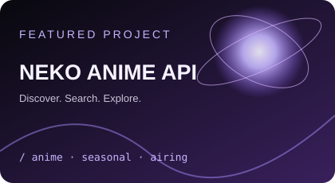

<h1>Hi, I'm Arjun 👋</h1>

  <strong>Electronics & Computer Engineering Student</strong> 
  Building projects, exploring technology, and learning by doing.

  
  

---

## 👨‍💻 About Me

- 🎓 Pursuing Electronics & Computer Engineering
- 💻 Learning programming, web development, and API integration
- 🛠️ Building practical software projects and exploring new technologies
- ⚡ Interested in electronics, computing, and problem-solving
- 🌱 Improving my skills through hands-on projects
- 📍 Kerala, India

## 🧰 Tech Stack

*Click any badge to visit its official website or documentation.*

  
  
  
  
  
  

## 🚀 Featured Project

<table>
  <tr>
    <td width="40%" align="center">
      
    </td>
    <td width="60%">
      <h3>Neko Anime API</h3>
      An anime discovery project exploring API-powered data, anime search, seasonal titles, and airing schedules.

        

      
      
    </td>
  </tr>
</table>

## 📊 GitHub Statistics

---

<i>Code. Build. Learn. Explore. Repeat.</i>

